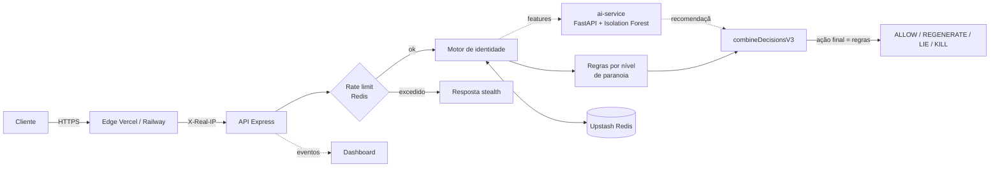

<div align="center">

# Rekuway IDN

### Identity Deadman Network

**Identidades temporárias que se defendem, travam quando o uso é suspeito e se autodestroem.**

[](https://github.com/andromedacripto/rekuway-idn/actions/workflows/ci.yml)
[](LICENSE)


[Visão geral](#visão-geral) · [Como funciona](#como-funciona) · [Quick start](#quick-start) · [API](#api) · [Modelo de segurança](#modelo-de-segurança) · [Desenvolvimento](#desenvolvimento) · [Roadmap](#roadmap)

</div>

---

## Visão geral

Rekuway IDN é uma API de **identidades temporárias com defesa ativa**. Cada identidade tem um par de chaves, um tempo de vida curto e um nível de paranoia. Quando alguém erra a chave privada, o sistema não responde com um erro claro. Ele **observa, regenera, engana e, se o ataque persistir, destrói a identidade**.

| O que o atacante vê                     | O que acontece de verdade                          |
| --------------------------------------- | -------------------------------------------------- |
| Respostas HTTP 200 idênticas            | O motor de decisão classifica a tentativa          |
| Uma "falha" sem pista sobre o motivo    | A identidade pode ser regenerada ou destruída      |
| Tempo de resposta quase constante       | Resposta normalizada para não vazar o caminho usado |

### Capacidades

- **Escada de defesa**: `ALLOW` → `REGENERATE` → `LIE` → `KILL`.
- **4 níveis de paranoia**: `low`, `medium`, `high`, `deadman`.
- **Deadman switch**: no nível `deadman`, a identidade exige heartbeat. Sem ele dentro do prazo, é destruída.
- **Camada stealth**: respostas uniformes e atraso aleatório curto, para não revelar o motivo da falha.
- **Rate limit por IP** em Redis (Upstash), com política fail-closed nas rotas sensíveis.
- **IA consultiva**: um serviço FastAPI (Isolation Forest) recomenda uma ação. **As regras continuam decidindo.**
- **Chaves de API** com autenticação por `Bearer` e limites por plano.

---

## Como funciona



### Escada de defesa

| Ação         | Efeito                                                                 |
| ------------ | ---------------------------------------------------------------------- |
| `ALLOW`      | Registra a falha e responde de forma uniforme.                          |
| `REGENERATE` | Destrói a identidade e cria outra, preservando os contadores do ataque. |
| `LIE`        | Registra o evento como ataque confirmado (com contexto do atacante) e responde de forma uniforme. Não devolve dados falsos. |
| `KILL`       | Destrói a identidade de forma definitiva.                               |

Depois de uma regeneração, a 1ª falha vira `LIE` e a 2ª vira `KILL`, em qualquer nível.

### Níveis de paranoia

Valores lidos de `src/config/paranoia.json`.

| Nível     | Regenera após | Máx. tentativas | TTL    | Deadman timer |
| --------- | ------------- | --------------- | ------ | ------------- |
| `low`     | 5 falhas      | 10              | 24 h   | não           |
| `medium`  | 3 falhas      | 5               | 1 h    | não           |
| `high`    | 2 falhas      | 3               | 30 min | não           |
| `deadman` | 1 falha       | 1               | 5 min  | 60 s          |

### Bloqueio de sessão (step-up, MFA e bloqueio)

Quando alguém usa uma identidade **com a credencial válida**, o motor ainda pontua o risco do uso. Se o risco passa do limite do nível, a sessão é **travada**: a chave continua válida, mas o servidor não concede acesso até o dono se autenticar de novo.

```
OPEN ──risco ≥ limite do nível──▶ CHALLENGE ──falhas ≥ máximo──▶ BLOCKED
  ▲                                  │  (reautenticação + MFA)        │
  └──────── step-up OK (carência) ───┘      bloqueio vence ───────────┘ (volta a CHALLENGE)
```

Sinais de risco (soma limitada a 1): IP diferente dos IPs onde a identidade já foi usada com sucesso (0,40), falhas antes do acesso válido (até 0,45), dispositivo diferente (0,20), país diferente (0,20), uso após regeneração (0,10) e a recomendação da IA (até 0,40, consultiva).

| Nível     | Trava a partir do risco | IP diferente sozinho | MFA | Falhas de step-up | Bloqueio | Carência após step-up | Se persistir |
| --------- | ----------------------- | -------------------- | --- | ----------------- | -------- | --------------------- | ------------ |
| `low`     | 0,60                    | passa                | não exigido | 5         | 5 min    | 30 min                | bloqueia     |
| `medium`  | 0,40                    | **trava**            | exigido | 4             | 15 min   | 15 min                | bloqueia     |
| `high`    | 0,35                    | **trava**            | exigido | 3             | 30 min   | 10 min                | bloqueia     |
| `deadman` | 0,20                    | **trava**            | exigido | 2             | 1 h      | 5 min                 | **destrói a identidade** |

Detalhes que importam:

- **Quem não tem a credencial não consegue travar o dono.** A trava só acontece depois de a credencial ser validada; tentativas com chave errada seguem o motor de defesa normal.
- **Sessão travada não renova nada.** `heartbeat` e `regenerate` são recusados (não estendem a vida de um deadman com credencial roubada). Um heartbeat vindo de IP novo também trava a sessão.
- **Reautenticar** é apresentar `identityId` + `privateKey` (ou o token) de novo em `POST /identity/step-up` com o `challengeId`. Com MFA exigido, vai junto o código TOTP de 6 dígitos (RFC 6238, compatível com Google Authenticator e similares). Cada código só vale uma vez.
- **Persistir piora.** Cada novo bloqueio dura o dobro do anterior (teto de 24 h). Ao fim de um bloqueio a sessão volta ao desafio, nunca ao acesso livre.
- **Depois de um step-up válido** o IP e o dispositivo atuais viram a nova referência, e o motor não reavalia durante a carência.
- **Roubo de token é detectado.** Cada uso troca o token. Se um token antigo reaparecer mais de 10 s depois da troca, existem duas cópias em mãos diferentes (o dono e um ladrão): a identidade é **destruída**, o dono é avisado (`TOKEN_REUSE`, severidade crítica) e quem apresentou o token velho recebe a resposta uniforme, sem saber de nada. Dentro dos 10 s o reuso é tratado como retry legítimo. O custo é que o dono precisa pedir uma identidade nova.
- **MFA** é emitido na criação (`POST /identity/new` devolve `mfa.secret` e `mfa.otpauthUri` uma única vez) para os níveis `medium`, `high` e `deadman`. O segredo fica cifrado no Redis. Sem MFA cadastrado (identidades antigas), o step-up exige só reautenticação, que protege contra token roubado, mas não contra chave privada roubada.
- **Suporte** libera uma sessão com `POST /internal/identities/:id/unlock` (`x-internal-secret`).

Os limites ficam em `src/config/paranoia.json` (`sessionPolicy`) e os pesos em `src/services/sessionGuard.ts`.

### IA consultiva (não decide)

1. A API extrai **9 features** comportamentais da tentativa.
2. Envia ao `ai-service` com um token interno. O timeout é curto e configurável.
3. A resposta entra em `combineDecisionsV3` apenas como **recomendação**.
4. A ação final é sempre a das **regras**. Qualquer divergência vai para o `auditLog`.
5. Se a IA estiver fora do ar, sem configuração ou lenta, o sistema segue **somente com regras**.

Contrato de features (fonte única: `ai-service/features.py`):

`attempt_interval_ms`, `attempt_count`, `total_attempts`, `regenerations`, `ip_change`, `fingerprint_reuse`, `user_agent_entropy`, `endpoint_sequence_score`, `hour_of_day` (UTC).

Um teste automatizado compara as chaves enviadas pelo cliente TypeScript com as do Python. Se os dois lados divergirem, o CI falha.

**Qualidade medida** (`python ai-service/evaluate.py`, 500 amostras normais e 500 ataques **sintéticos** gerados por `train.py`, semente fixa):

| Limiar de score | Falso positivo | Detecção |
| --------------- | -------------- | -------- |
| 0.50            | 8,8 %          | 100 %    |
| 0.70            | 0 %            | 63 %     |
| 0.85            | 0 %            | 15,6 %   |

Estes números valem apenas para o gerador sintético. Não são uma medida de desempenho com tráfego real, e o modelo ainda não foi avaliado fora desses dados.

---

## Quick start

### Requisitos

- Node.js 20 ou superior
- Uma instância Upstash Redis (REST)
- Python 3.12 (apenas para o `ai-service`, opcional)

### Rodando a API

```bash
git clone https://github.com/andromedacripto/rekuway-idn.git
cd rekuway-idn
npm ci

cp .env.example .env     # preencha os valores; nunca versione o .env
npm run build
npm start
```

Gere os segredos com `openssl rand -hex 32`.

### Rodando o serviço de IA (opcional)

```bash
cd ai-service
python -m venv venv && source venv/bin/activate
pip install -r requirements.txt
cp .env.example.txt .env  # defina AI_SERVICE_TOKEN
AI_SERVICE_TOKEN=... uvicorn main:app --port 8000
```

Na API, defina `AI_SERVICE_URL` e o **mesmo** `AI_SERVICE_TOKEN`. Sem eles, a IA fica desligada.

### Primeira chamada

```bash
# 1. Criar uma identidade (exige chave de API)
curl -X POST "$API/identity/new" \
  -H "Authorization: Bearer $RKWY_API_KEY" \
  -H "Content-Type: application/json" \
  -d '{"paranoiaLevel":"high"}'

# 2. Validar com o token devolvido
curl -X POST "$API/identity/check" \
  -H "Content-Type: application/json" \
  -d '{"token":"<token>"}'
```

---

## SDK e integração

Um cliente TypeScript sem dependências (`sdk/rekuway.ts`, Node 18+ e navegadores) traduz as respostas uniformes da API em resultados tipados e troca o token a cada uso:

```ts
import { Rekuway } from './sdk/rekuway';

const rk = new Rekuway({ baseUrl: process.env.REKUWAY_URL!, apiKey: process.env.RKWY_API_KEY });
const { session, mfa } = await rk.createSession('high'); // mostre `mfa` ao usuário uma vez

const r = await session.check();
if (r.status === 'step_up_required') await session.stepUp(codigoDoAutenticador);
```

- Chamando do **servidor** do seu produto, repasse o IP e o navegador do usuário (`session.check({ ip, userAgent })`) para o risco funcionar e para o limite ser o do seu plano, não o de 10 requisições por minuto por IP. Detalhes em [`docs/INTEGRATION.md`](docs/INTEGRATION.md).
- Contrato HTTP completo: [`docs/openapi.yaml`](docs/openapi.yaml) (validado).
- Casos de uso, tratamento dos estados e checklist de produção: [`docs/INTEGRATION.md`](docs/INTEGRATION.md).
- O SDK é testado contra a API real em `tests/integration/sdk.test.ts`.

---

## Modo agente (agentes de IA)

Para dar a um agente de IA um acesso **curto, com escopo e aprovado por uma pessoa**:

1. O dono cadastra quem aprova (`approver`) e recebe o QR do autenticador.
2. O agente (ou a plataforma dele) **pede acesso** dizendo o que precisa (`db:read`, `files:*`...), por quanto tempo e quantas vezes.
3. A pessoa **aprova com o código do celular**. Só então sai o token `agt_…` do agente.
4. **A cada uso**, o seu servidor pergunta à Rekuway `POST /agents/verify` ("este agente pode fazer `db:write` agora?").
5. Ações marcadas como **sensíveis** (`sensitiveScopes`) pedem uma aprovação humana nova, válida para **uma única chamada**.
6. A qualquer momento, `revoke` encerra o acesso na hora. Cada uso, permitido ou negado, fica na trilha de auditoria.

```ts
const { mfa } = await rk.agents.createApprover('maria');          // QR para a Maria, uma vez
const { requestId } = await rk.agents.requestAccess({
  agentId: 'assistente-financeiro', approverId: 'maria',
  scopes: ['db:read', 'db:write'], sensitiveScopes: ['db:write'], ttlSeconds: 3600,
});
const { token } = await rk.agents.approve(requestId, codigoDaMaria); // o agente recebe o token

app.get('/orders', agentGuard(rk, 'db:read'), handler);            // protege a rota
```

Diferenças em relação às identidades humanas: o token é **estável** (várias chamadas em paralelo funcionam), o risco **não** é medido por IP ou navegador (agentes mudam de IP o tempo todo) e os erros são **explícitos** para o agente saber o que fazer. Ver [`docs/INTEGRATION.md`](docs/INTEGRATION.md#agentes-de-ia).

## API

| Método | Rota                    | Auth                    | Função                                       |
| ------ | ----------------------- | ----------------------- | -------------------------------------------- |
| `POST` | `/api-keys`, `GET /api-keys/:userId`, `DELETE /api-keys/:hash` | `x-internal-secret` | Administração de chaves de API (só o dashboard). |
| `POST` | `/agents/*`             | `Authorization: Bearer` (chave de API) | Modo agente: aprovadores, pedidos, `verify`, aprovação de ação sensível, auditoria e revogação. Contrato em `docs/openapi.yaml`. |
| `POST` | `/identity/new`         | `Authorization: Bearer` | Cria uma identidade e devolve um token.       |
| `POST` | `/identity/check`       | token ou chave privada  | Valida e aplica o motor de defesa.            |
| `POST` | `/identity/step-up`     | token ou chave privada + `challengeId` (+ `code` TOTP) | Reautentica e destrava a sessão. |
| `POST` | `/internal/identities/:id/unlock` | `x-internal-secret` | Suporte: libera uma sessão travada ou bloqueada. |
| `POST` | `/identity/heartbeat`   | chave privada           | Renova o prazo do nível `deadman`.            |
| `POST` | `/identity/regenerate`  | chave privada           | Regenera a identidade sob demanda.            |
| `POST` | `/identity/kill`        | chave privada           | Destrói a identidade.                         |
| `POST` | `/api/verify-identity`  | `Authorization: Bearer` | Verificação para integradores.                |
| `GET`  | `/internal/stats`       | `x-internal-secret`     | Métricas internas. Recusa tudo sem segredo.   |
| `GET`  | `/internal/deadman-sweep` | `x-internal-secret` ou `Bearer CRON_SECRET` | Varredura do deadman para ambientes serverless. |
| `GET`  | `/health`               | nenhuma                 | Liveness.                                     |

Por design, qualquer falha (chave errada, identidade inexistente, limite excedido, JSON inválido) devolve a mesma resposta uniforme (`{"success":true,"status":"ok","mode":"stealth"}`), inclusive em `heartbeat`, `regenerate` e `kill`. Quando a credencial é válida mas o motor viu risco, a resposta é `action: "STEP_UP_REQUIRED"` (com `challengeId` e `methods`) ou `action: "BLOCKED"` (com `retryAfter`). Um cliente legítimo reconhece o sucesso pelo conteúdo: `action: "ALLOWED"` em `/identity/check`, `identity` em `heartbeat`, `token` em `regenerate`, `success` com `status: "created"` em `/identity/new`.

A cada `/identity/check` bem-sucedido por token, o token é **rotacionado**: a resposta traz o novo `token` e o anterior deixa de valer.

---

## Modelo de segurança

| Camada                 | Controle                                                                                          |
| ---------------------- | ------------------------------------------------------------------------------------------------- |
| Identidade do cliente  | IP lido de `X-Real-IP` (definido pelo edge da Vercel e da Railway). `X-Forwarded-For` é ignorado. |
| Rate limit             | 10 req / 60 s por IP em Redis, com `SCAN` (nunca `KEYS`) nas varreduras. Se o Redis falhar: fail-closed em rotas sensíveis, fail-open em leitura. |
| Segredos internos      | `validateInternalSecret()` com SHA-256 + `timingSafeEqual`. Sem `INTERNAL_SECRET`, tudo é recusado. |
| CORS                   | Somente origens de `ALLOWED_ORIGINS`. Vazio significa nenhuma origem de navegador.                |
| Serviço de IA          | `POST /analyze` exige o header `X-AI-Service-Token`, comparado em tempo constante.                |
| Criptografia           | Par RSA de 2048 bits gerado por identidade. A chave privada é entregue uma única vez e só o hash SHA-256 dela fica guardado; a validação compara esse hash (a chave pública não é usada para verificar assinaturas). |
| Tokens em repouso      | O token que carrega a chave privada é criptografado no Redis com AES-256-GCM (`TOKEN_ENCRYPTION_KEY`), preso ao identificador do token. |
| Sessão                 | Credencial válida com risco (IP novo, dispositivo novo, falhas anteriores, IA) trava a sessão: exige reautenticação e MFA por nível; se persistir, bloqueia (e destrói o `deadman`). |
| Credenciais            | `heartbeat`, `regenerate` e `kill` têm limite por IP e por identidade, respondem de forma uniforme e falham fechado. Comparações de segredo e de hash são em tempo constante. |
| Chaves de API          | Aceitas somente no header `Authorization`, nunca na URL. `/api-keys` exige `x-internal-secret`.    |
| Logs                   | Sanitizados: chaves privadas, chaves de API e segredos não são registrados.                       |
| Pipeline               | Prettier, `tsc`, ESLint, Vitest, `npm audit --audit-level=high` e verificações estruturais no CI. |

O relatório de testes e correções está em [PENTEST.md](PENTEST.md) (versão 2.1). Ele separa o que foi testado em produção do que foi corrigido por revisão de código.

### Segredos

O hook de pre-commit e o CI rodam `scripts/secret-scan.mjs` na árvore e em todo o histórico. Veja [`SECURITY.md`](SECURITY.md).

### Divulgação responsável

Encontrou uma vulnerabilidade? **Não abra uma issue pública.** Use *Security → Report a vulnerability* na aba do repositório no GitHub para enviar um relato privado.

---

## Configuração

Todas as variáveis estão em [`.env.example`](.env.example).

| Variável                                          | Obrigatória | Função                                                        |
| ------------------------------------------------- | ----------- | ------------------------------------------------------------- |
| `UPSTASH_REDIS_REST_URL`, `UPSTASH_REDIS_REST_TOKEN` | sim      | Armazenamento e rate limit.                                   |
| `INTERNAL_SECRET`                                 | sim         | Autentica `/internal/*` e as chamadas ao dashboard.           |
| `ALLOWED_ORIGINS`                                 | não         | Origens de navegador permitidas, separadas por vírgula.       |
| `AI_SERVICE_URL`, `AI_SERVICE_TOKEN`              | não         | Ligam a IA consultiva. Sem elas, só regras.                   |
| `AGENT_RATE_PER_MINUTE`                           | não         | Limite de usos por minuto de cada acesso de agente. Padrão 120. |
| `AI_SERVICE_TIMEOUT_MS`                           | não         | Timeout da chamada de IA. Padrão 3000.                        |
| `TOKEN_ENCRYPTION_KEY`                            | recomendada | 64 hex. Criptografa tokens no Redis. Sem ela, deriva de `INTERNAL_SECRET`. |
| `CRON_SECRET`                                     | não         | Autoriza o Vercel Cron em `/internal/deadman-sweep`.          |
| `IPAPI_PRO_KEY`                                   | não         | Geolocalização por HTTPS nos eventos. Vazio = sem consulta externa. |
| `DASHBOARD_URL`                                   | não         | Destino dos eventos de segurança.                             |
| `PORT`                                            | não         | Porta HTTP. Padrão 3000.                                      |

No `ai-service`: `AI_SERVICE_TOKEN` (obrigatória, sem ela o serviço responde 503), `ALLOWED_ORIGINS`, `MODEL_SHA256` (opcional: só carrega o modelo com este hash) e `AI_THRESHOLD_REGENERATE` / `_LIE` / `_KILL`.

---

## Desenvolvimento

```bash
npm run check         # format:check + tsc + eslint + testes
npm test              # Vitest
npm run lint          # ESLint (src/ e tests/unit/)
npm run format        # Prettier
npm run typecheck     # tsc --noEmit
```

**Hooks (Husky):** `pre-commit` roda `lint-staged` (Prettier + ESLint nos arquivos alterados) e `tsc`. `pre-push` roda os testes.

### Testes

`npm test` roda testes unitários e de integração (a aplicação Express completa, com Redis e banco em memória). `python -m pytest ai-service/test_api.py` testa o contrato HTTP do serviço de IA.

Os testes cobrem:

- o motor de decisão nos 4 níveis de paranoia;
- o deadman timer (limite estrito de 60 s);
- `validateInternalSecret`, incluindo o caso fail-closed;
- a extração do IP do cliente;
- o contrato de features entre TypeScript e Python;
- a criptografia dos tokens em repouso, a rotação de token e o fluxo completo de identidade;
- fail-open e fail-closed com o Redis fora do ar, CORS, `/api-keys` protegido e o sweep do deadman;
- o bloqueio de sessão: IP diferente, step-up com MFA, anti-replay do código, bloqueio com duração dobrada, destruição no `deadman`, desbloqueio de suporte e a garantia de que um atacante sem credencial não trava o dono.

Os scripts `test-*.sh` e `pentest-rekuway.sh` são testes manuais contra uma instância em execução.

### Estrutura

```
src/
  index.ts            # app Express, CORS e rate limit
  routes/             # identity, api-keys, internal, verify-identity
  services/           # decisionEngine, defensiveService, railwayAiClient, ...
  middleware/         # autenticação por chave de API, logger de segurança
  utils/              # internalSecret, clientIp, sanitize, crypto
  config/             # paranoia.json, database (Upstash)
ai-service/           # FastAPI + Isolation Forest (features.py = contrato)
tests/unit/           # Vitest
api/                  # entrypoint do Vercel
```

### Deploy

- **Vercel**: `vercel.json` aponta para `api/index.js`, que carrega o build de `dist/`. Como não há processo longo, agende uma chamada a `GET /internal/deadman-sweep` com `Authorization: Bearer $CRON_SECRET` (Vercel Cron ou um agendador externo). O prazo do deadman também é aplicado em cada `/identity/check`.
- **Railway**: `railway.json` executa `node dist/index.js`; o monitor do deadman roda dentro do processo, a cada 5 s.

Configure as variáveis acima nos dois ambientes. Em cada ambiente, `INTERNAL_SECRET` e `AI_SERVICE_TOKEN` devem ter valores próprios.

---

## Roadmap

- [x] Histórico do git reescrito sem os segredos (verificado por scanner); falta publicar com `git push --force` e rotacionar as credenciais antigas (veja `SECURITY.md`)
- [ ] Treinar e validar o detector com tráfego real (hoje só dados sintéticos)
- [ ] Limites de taxa por plano de API
- [ ] Teste de intrusão por terceiros
- [ ] mTLS entre serviços internos
- [ ] Medir e publicar latência e capacidade com benchmarks reproduzíveis

---

## Licença

MIT. Veja [LICENSE](LICENSE).

<div align="center">

Feito por [andromedacripto](https://github.com/andromedacripto)

</div>
